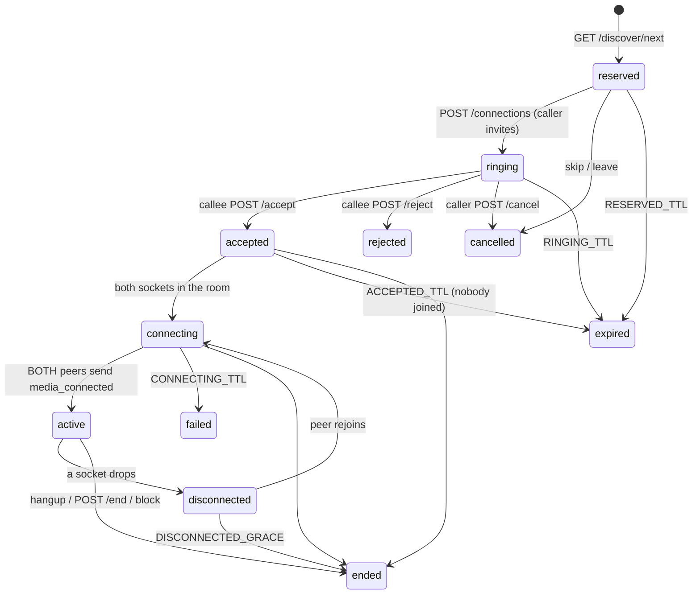

# Call lifecycle & WebSocket protocol

## State machine (`backend/app/calls.py`)

Terminal: `ended, rejected, cancelled, expired, failed`. Invalid transitions return HTTP 409.
Camera/microphone are requested by the browser only after the call is `accepted`.

## Sockets
Never put the access token in a URL. Request a single-use ticket (valid 60 s) with the bearer token, then connect:

| Channel | Ticket | Socket |
|---|---|---|
| Push (incoming calls, accept/decline, friend events) | `POST /auth/ws-ticket` | `/ws/user?ticket=…` |
| Call room (signalling + chat) | `POST /connections/{id}/ws-ticket` (only after accept) | `/ws/connection/{id}?ticket=…` |

A ticket is bound to one user, scope and room, is rejected on replay, and is not accepted as an API token (and vice versa).
In production the `Origin` header must be listed in `CORS_ORIGINS`. Non-participants, unaccepted/ended calls and blocked pairs are refused at the handshake (close 1008).

### Client → server (room)
`offer`/`answer` `{data:{type,sdp}}` (sdp ≤ 40 000 chars), `ice-candidate` `{data:{candidate,sdpMid,sdpMLineIndex,usernameFragment}}`,
`chat` `{text ≤ 1000}`, `media_connected`, `hangup`, `ping`. Unknown types/fields → `{"type":"error"}`; frames > 64 KB close the socket (1009).
Limits: 200 messages / 10 s per user per room; 10 chat messages / 10 s.

### Server → client (room)
`room_state {peers, peer_id}`, `peer_joined {user_id}`, `peer_left {user_id}`, `offer|answer|ice-candidate {from,data}`, `chat {from,text}`, `hangup {from}`, `pong`, `error`.
Close code 4000 = call finished; 4009 = replaced by a newer connection of the same user.

### Server → client (user channel)
`incoming_call {connection_id, from, expires_in}`, `call_accepted`, `call_rejected`, `call_ended {status, reason}`, `call_active`, `peer_disconnected`, `friend_request`, `friend_accepted`.
Polling fallbacks exist: `POST /presence/heartbeat` returns `incoming_call`; `GET /calls/incoming`; `GET /connections/{id}/status`.

**Limitation:** the hub is in-process. Run a single worker until a shared pub/sub is added.
